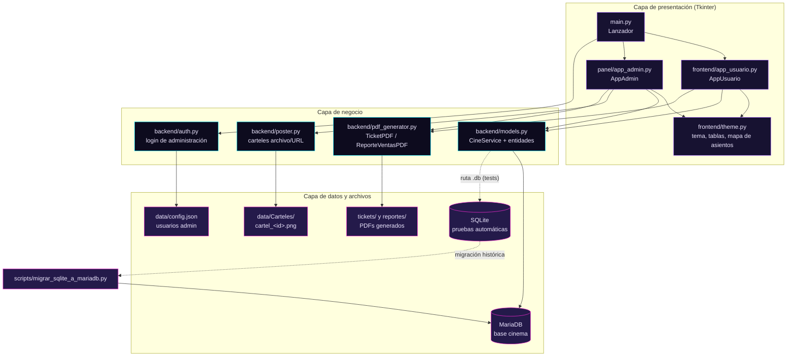
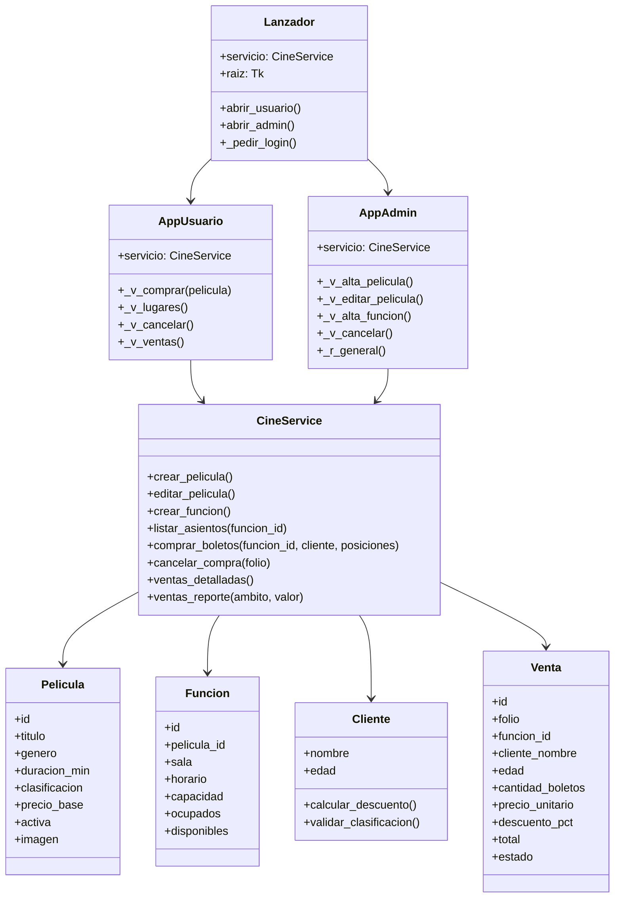
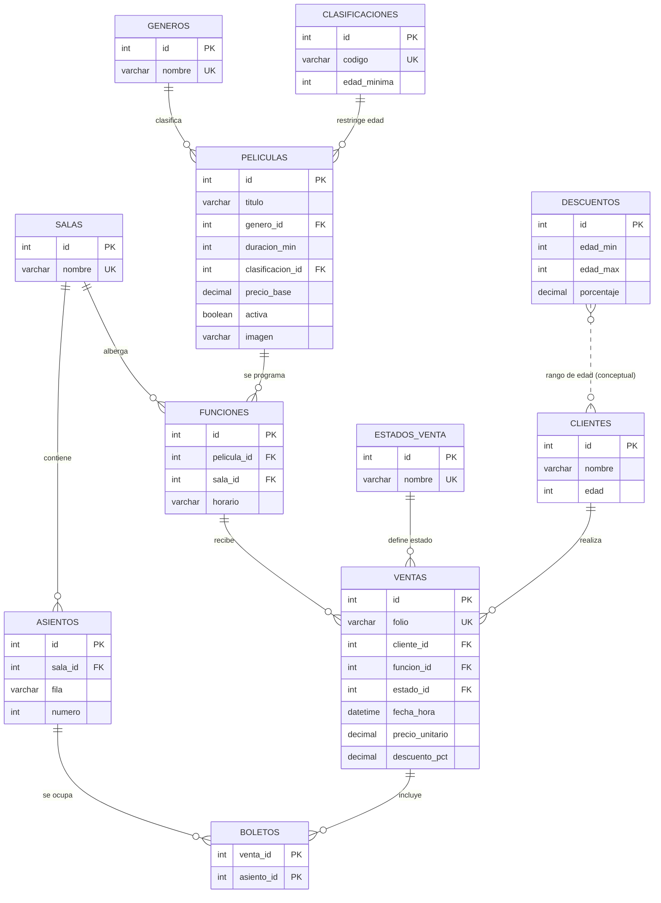
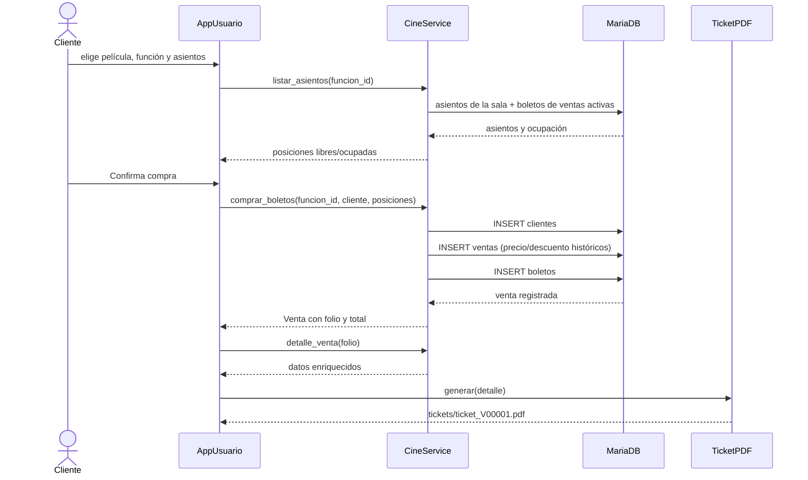

# Diagramas de Cinema

Este archivo contiene el código **Mermaid** de los diagramas del proyecto. Se
puede visualizar directamente en GitHub, en VS Code (extensión Markdown
Preview Mermaid) o pegando cada bloque en <https://mermaid.live>.

## 1. Diagrama general del proyecto

## 2. Diagrama de clases principal

## 3. Diagrama entidad-relación de la base de datos (3FN)

`BOLETOS` es la tabla asociativa de la relación N:M entre `VENTAS` y
`ASIENTOS`. La función de una venta se obtiene por `VENTAS.funcion_id`; la
disponibilidad de un asiento se calcula cruzando `BOLETOS` con las ventas
`activa` de esa función y la sala del asiento.

## 4. Flujo de compra y generación del ticket

## 5. Normalización aplicada

- **1FN**: todos los atributos son atómicos. `asientos` separa `fila` y
  `numero`; la posición `F-5` se deriva en la consulta.
- **2FN**: `boletos` tiene clave compuesta `(venta_id, asiento_id)` y no
  contiene atributos dependientes de una sola parte de la clave.
- **3FN**: los catálogos (`generos`, `clasificaciones`, `descuentos`,
  `estados_venta`) y las entidades (`salas`, `asientos`, `peliculas`,
  `funciones`, `clientes`, `ventas`) están separados. No hay dependencias
  transitivas: el género, la clasificación, la sala y el estado se referencian
  por ID.
- **Datos derivados**: `funciones` no almacena capacidad ni ocupados;
  `asientos` no almacena estado ni posición; `ventas` no almacena cantidad de
  boletos ni total. Se calculan con `COUNT`, joins y las reglas de negocio.
- **Histórico**: `ventas.precio_unitario` y `ventas.descuento_pct` son
  instantáneas de la compra, no valores derivados del catálogo actual.
